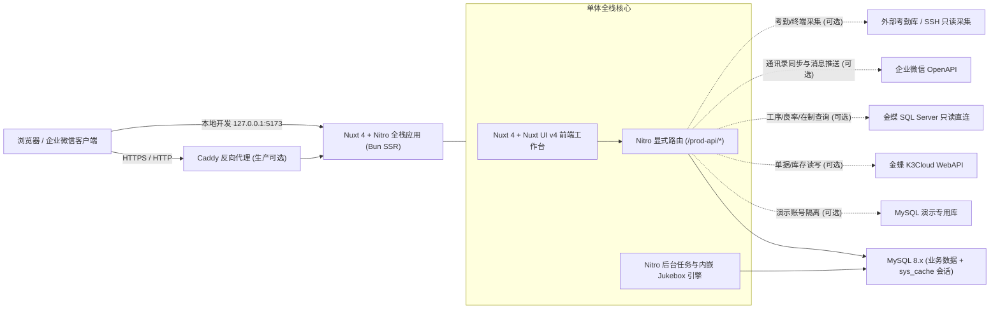

# ctk-system

[](https://nuxt.com/)
[](https://nitro.build/)
[](https://ui.nuxt.com/)
[](https://bun.sh/)
[](LICENSE)

面向制造业与企业日常运营的开源全栈管理系统，基于 **Bun + Nuxt 4 + Nitro** 单体全栈架构构建。系统将前端业务工作台、显式 Nitro 服务端 API、MySQL 持久化状态与可选的 ERP（金蝶 K3Cloud）/ 企业微信 / 厂区广播等集成能力整合在单一代码仓库中，并原生支持**白标化企业品牌注入**。

[核心业务能力](#核心业务能力矩阵) · [技术栈与架构](#技术栈与高层架构) · [快速开始](#快速开始) · [文档导航](#文档导航) · [开源协议](#开源协议与安全说明)

---

## 核心业务能力矩阵

系统导航与权限控制由 `app/router/static-navigation.js` 与 `sys_menu` 共同维护，覆盖以下核心业务域：

| 业务域 | 核心功能模块 | 关键特性与集成 |
| --- | --- | --- |
| **生产制造与车间在制** | 生产订单、生产进度、生产质量、产量汇报、车间半成品在制（WIP）、车间半成品盘点、生产入库、假片重量月度录入；异常单、异常看板、弹坑图片、意见建议、视频资料库、焊线机工卡打印 | 对接 SQL Server 工序与质量数据直连，支持车间在制核算、良率追踪、异常闭环与工卡打印 |
| **供应链与金蝶 K3Cloud 集成** | 供应商准入与测试（采购管理）、金蝶快捷指令、外发上锡导出 | 采用 **WebAPI + SQL Server 直连**双链路集成金蝶 K3Cloud，读写职责清晰隔离 |
| **销售报价、交期与应收预警** | 外贸销售报价单、内贸销售报价单、销售价格走势、客户逾期应收、客户样品进度、销售交期预警 | 支持多模板报价工作簿导出、企微审批通知、价格趋势分析、逾期应收管控与交期风险提醒 |
| **仓储库存与安全库存预警** | 库存预警、金蝶即时库存、多仓/分栋库存查询、仓库结构、采购入库、销售出库、库位上架、标签管理 | 支持安全库存阈值维护、缺口可视化预警、定时播报推送及条码标签打印 |
| **企微考勤与人事协同** | 企业微信通讯录、企业微信消息、考勤核算、入离职汇总、人才库、ESD 门禁记录 | 支持企业微信组织架构自动同步、应用消息推送、外部考勤库只读核算与门禁记录查询 |
| **IT 资产台账** | IT 资产管理 | 统一维护终端与办公设备台账，支持可选的外部终端安全系统只读 SSH 采集同步 |
| **厂区广播 Jukebox** | 厂区广播 | 内嵌 `mpv` + `ffprobe` 多媒体播控引擎，支持定时节目编排、音量控制与媒体文件备份 |
| **系统管理与运行监控** | 用户/角色/部门/岗位/权限目录、字典管理、参数设置、通知公告；在线用户、定时任务、操作/登录日志、缓存监控、服务监控 | 基于 RBAC 的菜单与按钮级权限控制；所有会话与缓存统一落盘 MySQL `sys_cache` 表 |

---

## 技术栈与高层架构

### 核心技术栈

- **运行时与构建**：[Bun](https://bun.sh/) 1.4+（包管理、脚本运行、开发与生产 SSR）
- **前端框架**：Nuxt 4 · Vue 3.5 · Nuxt UI v4 · Tailwind CSS 4 · Pinia · VueUse
- **数据展示与交互**：ECharts 6 · RevoGrid 数据网格 · `xlsx-js-style` 电子表格导入导出 · ZXing 扫码
- **服务端与校验**：Nitro（显式 `server/routes/prod-api/` 路由）· Zod 4 参数校验
- **数据存储**：MySQL 8.x（`mysql2`，承载业务表与 `sys_cache` 进程外状态）· Microsoft SQL Server（`mssql`，可选 ERP 账套直连）
- **工程质量**：Vitest 5 + Happy DOM 单元测试 · ESLint 10 静态检查 · SQL 迁移目录门禁

### 高层架构图



### 前端公共模块包

业务页面通过路径别名导入公共能力，实现 UI、请求与领域纯函数的清晰分层：

| 目录 | 导入别名 | 职责说明 |
| --- | --- | --- |
| `app/packages/api` | `@ctk-system/api` | 统一请求封装与业务 API 模块聚合 |
| `app/packages/composables` | `@ctk-system/composables` | `useTkListQuery`、`useTkRowInteraction` 等列表与交互组合式函数 |
| `app/packages/ui` | `@ctk-system/ui` | `TkUTable`、`TkSearchPanel`、`TkToolbar` 等通用业务组件 |
| `app/packages/shared` | `@ctk-system/shared` | 日期范围、格式化、口径计算等可独立单测的纯函数 |

---

## 快速开始

### 环境要求

- **[Bun](https://bun.sh/) 1.4+**
- **MySQL 8.0+**（推荐使用 `utf8mb4` 字符集；`sys_cache` 表会在首次连接时按需初始化）
- **可选依赖**：Docker & Docker Compose（用于容器化部署）；金蝶 K3Cloud、SQL Server、企业微信、外部考勤库与 Jukebox 均按需配置，**未配置时核心系统与单元测试仍可正常运行**

### 方式一：本地开发（`local.env` + `bun run dev`）

#### 1. 准备本地环境变量

复制模板文件 `local.env.example` 为 `local.env`（该文件已列入 `.gitignore`，切勿提交至版本库）：

```powershell
# Windows PowerShell
Copy-Item local.env.example local.env
```

```bash
# macOS / Linux
cp local.env.example local.env
```

编辑 `local.env`，至少填写以下本地开发配置：

- `TK_MYSQL_URL` / `TK_MYSQL_USERNAME` / `TK_MYSQL_PASSWORD`：指向本地 MySQL 实例
- `NUXT_AUTH_TOKEN_SECRET` / `NUXT_LEGACY_TOKEN_SECRET`：填写本地随机生成的签名密钥
- 若暂不接入企业微信与 ERP，可将 K3 / SQL Server / WeCom 凭据留空，并设置 `NUXT_WECOM_AUTO_SYNC_ENABLED=0`

#### 2. 初始化 MySQL 数据库

创建目标数据库后，按顺序导入 `db/sql/schema/` 下的表结构与 `db/sql/data/` 下的最小初始化 Seed 数据：

```bash
# 1. 导入基础表结构（及后续增量 schema 文件）
mysql -u <user> -p --default-character-set=utf8mb4 <database> < db/sql/schema/20261113_init_schema.sql

# 2. 导入最小初始化数据（基础角色、菜单、字典与占位账号）
mysql -u <user> -p --default-character-set=utf8mb4 <database> < db/sql/data/20261113_init_seed.sql
```

> [!IMPORTANT]
> 导入 Seed 数据后，请务必立即重置管理员与演示账号的默认密码，切勿在任何共享或生产环境保留占位凭证。

#### 3. 安装依赖并启动

```bash
# 安装依赖
bun install

# 启动本地开发服务器（Bun 自动加载 local.env）
bun run dev

# 运行全量单元测试（不依赖外部 ERP / 企业微信）
bun run test
```

启动成功后可访问：

- 前端页面：<http://127.0.0.1:5173>
- 服务端 API：<http://127.0.0.1:5173/prod-api>

> 若 `5173` 端口已被占用，请先释放占用端口的进程后再运行 `bun run dev`。

### 方式二：Docker Compose 部署（`.env.docker`）

仓库内置 `Dockerfile` 与 `docker-compose.yml`，包含 `app`（Nitro Bun SSR，监听 `127.0.0.1:3100`）、`caddy`（反向代理，监听 `80`）以及可选的 `mysql`（MySQL 8.4，通过 `--profile local-db` 启用）。

```bash
# 1. 复制容器环境变量模板并按需填写（切勿提交 .env.docker 到 Git）
cp .env.docker.example .env.docker

# 2. 使用外部独立 MySQL 启动应用与 Caddy
docker compose up -d --build

# 如需同时启动内置 MySQL 8.4 容器，追加 local-db profile：
docker compose --profile local-db up -d --build
```

完整的持久化卷挂载、健康检查、定时任务开关与升级流程，请查阅 [部署与配置指南](docs/deployment.md)。

### 白标企业名称注入机制

本仓库源码保持纯白标，不包含任何真实企业名称或私密配置。部署方只需在 `local.env` 或 `.env.docker` 中配置以下环境变量，系统即会在页面标题、登录页品牌区、页脚及服务端导出报表中自动展示自有企业信息：

```env
NUXT_PUBLIC_APP_TITLE=企业运营管理系统
NUXT_PUBLIC_BRAND_TITLE=示例企业运营平台
NUXT_PUBLIC_BRAND_SUBTITLE=制造与供应链一体化工作台
NUXT_PUBLIC_BRAND_MARK=DEMO
NUXT_PUBLIC_BRAND_FOOTER=示例企业有限公司
NUXT_PUBLIC_COMPANY_NAME=示例企业有限公司
COMPANY_DISPLAY_NAME=示例企业有限公司
ATTENDANCE_COMPANY_TITLE=示例企业有限公司
```

### 常用开发命令

| 命令 | 说明 |
| --- | --- |
| `bun run dev` | 启动本地开发环境（Nitro + Vite 热重载，自动加载 `local.env`） |
| `bun run test` | 运行 Vitest 全量单元测试 |
| `bun run lint` | 运行 ESLint 静态代码检查 |
| `bun run check:sql` | 校验 `db/sql/` 目录结构（DDL/DML 分离）与文件命名规范 |
| `bun run build` | 构建生产 SSR 产物（发布或容器构建时使用） |
| `bun run preview` | 本地预览生产构建产物 |

---

## 文档导航

| 文档 | 内容说明 |
| --- | --- |
| [系统架构与工程规范](docs/architecture.md) | Nuxt 4 + Nitro 分层架构、目录组织、`sys_cache` 会话机制、静态导航与权限体系、ERP 双链路与测试门禁 |
| [核心业务模块与外部集成](docs/modules.md) | 各业务域路由清单、核心能力说明，以及金蝶 K3Cloud、企业微信等可选外部集成详解 |
| [本地开发、生产部署与白标配置指南](docs/deployment.md) | 本地与 Docker Compose 完整部署步骤、环境变量全量说明、白标品牌注入与公私资产隔离实践 |
| [安全策略与密钥管理规范](SECURITY.md) | 安全漏洞私密上报渠道、敏感配置保护边界与 Seed 凭证重置要求 |
| [AI / Agent 协作规约](AGENTS.md) | 仓库开发原则、代码与 UI 规范、数据库变更与验证门禁 |

---

## 开源协议与安全说明

- **开源协议**：本项目基于 **GNU General Public License v3.0 or later (`GPL-3.0-or-later`)** 发布，完整协议条款请参阅 [LICENSE](LICENSE)。
- **安全与敏感信息边界**：请勿将 `local.env`、`.env.docker`、`deploy.config.json`、私钥证书、真实企业名称、内网 IP 或生产业务数据提交到公开 Git 仓库。发现潜在安全漏洞请通过 [SECURITY.md](SECURITY.md) 中的私密渠道上报。
- **免责声明**：本软件按「现状（AS IS）」提供，不附带任何明示或暗示的担保。在将系统接入生产数据库或启用外部 ERP 写操作、定时任务之前，请务必先在独立测试环境完成完整验证与数据备份。
