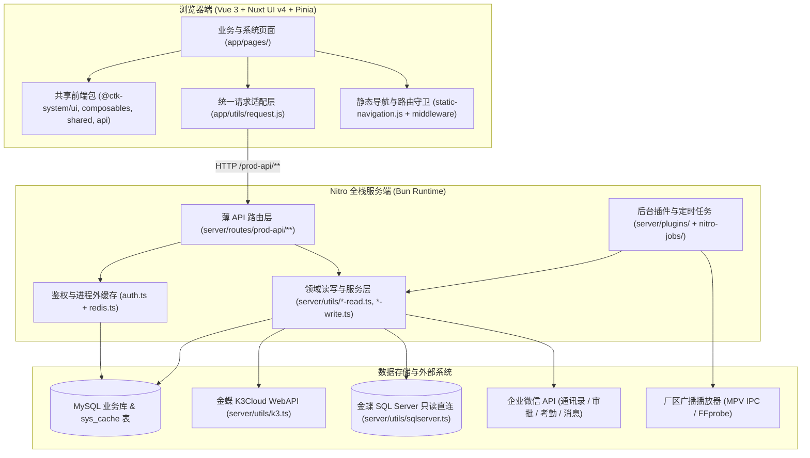
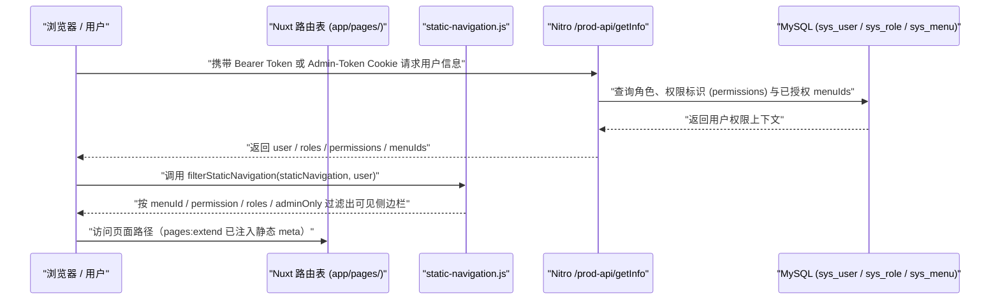

# 系统架构与开发指南

本文档面向参与 **ctk-system** 二次开发、架构评审与日常维护的工程师，系统性说明本仓库的 Nuxt 4 + Nitro 单体全栈分层架构、目录约定、核心运行机制与质量门禁。

- 部署与白标环境配置请参见 [部署与白标配置指南](./deployment.md)
- 业务域功能与外部集成清单请参见 [核心业务模块与集成说明](./modules.md)
- 仓库协作规约与安全边界请参见 [AGENTS.md](../AGENTS.md)

---

## 1. 技术栈与单体全栈分层架构

**ctk-system** 基于 **Bun + Nuxt 4 + Nitro** 构建单体全栈应用（无独立 Java/Spring 后端），前后端共享同一仓库、同一运行时与统一配置入口：

| 层级 | 技术选型 | 核心职责 |
| --- | --- | --- |
| 运行时与包管理 | Bun (`bun@1.4.0`) + Nitro (`preset: "bun"`) | 本地开发、服务端渲染、API 路由执行与定时任务承载 |
| 前端框架 | Nuxt 4 (`compatibilityVersion: 4`) + Vue 3.5 + Pinia + Vue Router | 文件系统路由、状态管理、权限守卫、SPA 后台工作台 |
| UI 与可视化 | `@nuxt/ui` v4 + Tailwind CSS v4 + ECharts 6 + RevoGrid | 亮暗双主题语义化组件、高密度数据表格、电子表格式编辑器与图表 |
| 服务端 API | Nitro File-based Routes (`server/routes/prod-api/`) | REST API 鉴权、参数校验、文件导出、业务编排 |
| 持久化与缓存 | MySQL (`mysql2`) + `sys_cache` 表 | 核心业务数据、RBAC 权限模型及进程外会话/缓存存储 |
| 外部集成 | 金蝶 K3Cloud WebAPI + SQL Server (`mssql`) + 企业微信 API + MPV/FFprobe | ERP 单据与库存同步、生产工序直连查询、考勤通讯录与厂区广播 |

### 整体分层架构图



### 渲染策略说明

根据 `nuxt.config.ts` 的 `routeRules` 配置：

- `/login` 开启 `ssr: true`，确保登录页首屏直出与快速响应；
- 其余后台工作台路由 `/**` 当前采用 `ssr: false`（客户端渲染 SPA 壳），避免大量浏览器专属依赖（如电子表格网格、条码扫描、富文本编辑器）阻塞服务端渲染；
- 生产环境通过 Nitro `serverAssets` 将报价单 Excel 模板（`server/templates/*.xlsx`）打包为服务端私有资产，不暴露到公开静态目录。

---

## 2. 仓库目录结构

```text
ctk-system/
├── app/                              # Nuxt 4 前端源码根（alias: @ / ~）
│   ├── pages/                        # 文件系统路由页面
│   │   ├── system/                   # 系统管理（用户、角色、部门、岗位、菜单、字典、参数、公告）
│   │   ├── monitor/                  # 系统监控（在线用户、定时任务、操作/登录日志、缓存、服务）
│   │   ├── tk_custom/                # 制造业与企业运营核心业务页
│   │   ├── user/                     # 个人中心
│   │   ├── login.vue / register.vue  # 登录与注册页
│   │   └── index.vue / demo.vue      # 首页与演示入口
│   ├── packages/                     # 前端内部公共包（@ctk-system/*）
│   │   ├── api/                      # 业务接口工厂与模块化定义（@ctk-system/api）
│   │   ├── composables/              # 通用组合式函数（useTkListQuery、useTkRowInteraction 等）
│   │   ├── shared/                   # 纯函数工具（日期范围、条码、数字格式化、报价计算等）
│   │   └── ui/                       # 公共业务组件（TkUTable、TkSearchPanel、TkToolbar 等）
│   ├── api/tk_custom/                # 兼容历史导入路径的薄 re-export 层
│   ├── router/static-navigation.js   # 静态导航树与权限过滤逻辑
│   ├── middleware/                   # 路由鉴权与跳转守卫
│   ├── store/                        # Pinia 状态管理（用户、权限、标签页、应用设置）
│   ├── utils/request.js              # 唯一前端 HTTP 请求适配层（基于 $fetch）
│   └── __tests__/                    # Vitest 单元测试（前端组件 + Nitro 服务端 handler）
├── server/                           # Nitro 服务端源码
│   ├── routes/prod-api/              # 对外 API 路由（system / monitor / k3 / kingdee / tk_custom / common）
│   ├── utils/                        # 核心领域逻辑（按 <domain>-read.ts / <domain>-write.ts 组织）
│   │   ├── nitro-jobs/               # 统一注册表管理的定时任务实现
│   │   └── jukebox/                  # 厂区广播播放引擎、调度器与 IPC 通信
│   ├── plugins/                      # Nitro 启动期挂载的后台守护与调度插件
│   └── templates/                    # 服务端私有报表/报价模板（不公开暴露）
├── db/sql/                           # 数据库迁移资产（由 bun run check:sql 校验）
│   ├── schema/                       # 仅放结构变更 DDL（YYYYMMDD_描述.sql）
│   └── data/                         # 数据初始化/菜单/字典/修复 DML（YYYYMMDD_描述.sql）
├── docs/                             # 开源项目文档（架构、业务模块、部署配置）
├── tools/                            # 工程化校验脚本（如 check-sql-migration-layout.mjs）
├── nuxt.config.ts                    # Nuxt 4 / Nitro / RuntimeConfig 核心配置
├── vitest.config.js                  # Vitest 测试环境与路径别名配置
└── eslint.config.mjs                 # 轻量级静态代码检查配置
```

### 前端分层约束

- **统一请求入口**：所有前端请求经 `app/utils/request.js` 发出，页面继续从 `@/api/tk_custom/...` 或 `@ctk-system/api` 导入，不在模块里重复封装 Token 注入或第二套错误拦截器。
- **列表查询范式**：标准分页列表统一组合 `useTkListQuery`（`app/packages/composables/useTkListQuery.js`），自动处理并发竞态（只认最后一次响应）与非 `200` 响应时保留旧数据并写入 `error`。
- **表格与行交互**：公共数据表 `TkUTable`（`app/packages/ui/TkUTable.vue`）采用「单击选中、再击取消、双击通过 `@row-open` 打开详情」的统一交互；多选列通过显式 `id: 'select'` 列与 `UCheckbox` 绑定。
- **公共组件自动注册**：`nuxt.config.ts` 已将 `app/packages/ui/*.vue` 配置为全局自动导入组件，业务页可直接使用 `TkSearchPanel`、`TkToolbar`、`TkUTable` 等组件。

---

## 3. 核心运行机制

### 3.1 MySQL `sys_cache` 进程外会话与缓存

系统不依赖独立 Redis/Garnet 进程，而是通过 `server/utils/redis.ts` 在 MySQL 中维护 `sys_cache` 表承载进程外状态（登录会话、图形验证码、登录失败锁定、写操作幂等键），从而在 Nitro 进程重启或发布更新时保持在线用户不掉线：

- **表结构与自愈**：`sys_cache` 包含 `cache_key`（主键）、`cache_value`（`MEDIUMTEXT`）、`expire_time`（带索引，`NULL` 表示永不过期）；`ensureCacheTable()` 在表缺失时自动兜底建表。
- **兼容接口**：导出语义化的 `getCache()`（同时保留历史别名 `getGarnet()`），提供 `get / set(EX/PX/NX) / del / mget / keys / scan / info / dbsize` 最小接口集。
- **过期清理**：`server/plugins/sys-cache-cleanup.ts` 定期清理已过期键；后台「缓存监控」页执行清空缓存时，显式跳过会话前缀（`SESSION_KEY_PREFIXES`），避免误踢全员下线。
- **双键会话机制（重要）**：
  - `server/utils/auth.ts` 写入会话时同时保存主键 `auth_sessions:<tokenId>` 与兼容副本 `login_tokens:<tokenId>`。
  - 读取会话时若主键缺失，会回退读取兼容副本并经 `normalizeLegacySession()` 标准化。
  - 因此撤销会话（强制下线、修改权限、退出登录）**必须统一调用 `deleteAuthSession()` 同时删除两个前缀**，切勿仅清理单个前缀。

### 3.2 静态导航与 RBAC 权限过滤

系统采用「**文件系统决定路由，静态树决定菜单结构，数据库 `sys_menu` 决定授权**」的分离设计：



- `nuxt.config.ts` 的 `pages:extend` 钩子会在构建期将 `app/router/static-navigation.js` 中定义的 `title`、`icon`、`permission`、`menuId` 等元数据合并到 Nuxt 生成的路由表上。
- `sys_menu` 表**仅用于角色授权与按钮级权限判断**，不再在运行时动态拼接组件路径或注册路由。
- 权限校验规则见 `canAccessStaticRoute()`：超级管理员（`user.id === 1`）默认放行；普通用户按 `menuId` / `additionalMenuIds`、通配权限串（如 `tk_custom:quotation:*`）及角色集合综合判定；标注 `adminOnly: true` 的路由仅限管理员访问。

### 3.3 外部 ERP 双数据链路架构

与金蝶 K3Cloud ERP 的交互严格拆分为**两条独立链路**，开发与排查时不得混用：

| 链路 | 服务端模块 | 底层协议 | 典型用途 | 关键特性 |
| --- | --- | --- | --- | --- |
| **ERP WebAPI 链路** | `server/utils/k3.ts`、`server/utils/k3-config.ts` | HTTPS / JSON (`*.common.kdsvc`) | 即时库存查询、采购入库/销售出库单据写入、保存/提交/审核/反审/删除/下推 | 支持 `LoginByAppSecret` 会话复用、自动跳过代理直连内网地址、按 `K3CloudError.kind` 区分配置/超时/权限/查询错误 |
| **SQL Server 直连链路** | `server/utils/sqlserver.ts` | TDS (`mssql` 连接池) | 生产订单、工序计划、生产质量良率、产量汇报、车间在制（WIP）、交期与逾期应收统计 | 支持主备主机容灾（`sqlServerK3Host` / `sqlServerK3HostFallback`）、IP 直连 TLS SNI 兼容、独立连接与查询超时控制 |

> **安全边界**：在演示模式（`isDemoScope()`）下，两条外部链路均会拦截并抛出 `DemoModeError`，防止演示环境访问或污染真实 ERP 数据；任何 ERP 写入动作均需核对目标 `FormId`、字段映射与单据最终状态。

### 3.4 Nitro 后台插件与定时任务体系

后台定时任务与守护进程运行在 Nitro 服务端，分为两类：

1. **统一注册表任务（`server/plugins/nitro-legacy-jobs.ts` + `server/utils/nitro-jobs/registry.ts`）**：
   - 将历史定时任务收敛为 `NITRO_JOBS` 注册表（包含库存全量/增量同步、库存预警推送与快照、企微审批同步与提醒、企微员工同步、建议推送、逾期冻结、广播同步、上传目录巡检等 11 项任务）。
   - **安全默认关闭**：所有任务默认处于关闭状态，仅当环境变量 `NUXT_NITRO_JOB_<KEY>=1` 或数据库 `sys_config` 中 `nitro.job.<key>=1` 时才启用。
   - **防误写保护**：统一调度器自动触发时强制以 `dryRun=true`（只检查不落库）运行，真实写入需经手动管理接口或专用插件确认。
2. **专用业务守护插件（`server/plugins/*.ts`）**：
   - 包括缓存过期清理（`sys-cache-cleanup.ts`）、错误日志记录（`error-logger.ts`）、MySQL 主机解析（`mysql-host-resolve.ts`）、企微通讯录自动同步（`wecom-auto-sync.ts`）、库存同步/预警推送/快照（`kucun-sync-scheduler.ts`、`kucun-warning-push.ts`、`kucun-warning-snapshot.ts`）、销售交期与逾期应收提醒（`sales-delivery-alert.ts`、`customer-overdue-ar-alert.ts`）、报价单提醒与月报（`quotation-reminder.ts`、`domestic-quotation-monthly.ts`）、生产订单关闭巡检（`production-order-close.ts`）及厂区广播播放引擎（`jukebox-player.ts`）。

---

## 4. 数据库迁移规约与质量门禁

### 4.1 SQL 迁移目录规范

`db/sql/` 采用结构变更与数据变更分离的目录约定，由 `tools/check-sql-migration-layout.mjs` 强制校验：

- **结构变更（仅 DDL）**：放入 `db/sql/schema/YYYYMMDD_描述.sql`，禁止出现 `INSERT / UPDATE / DELETE / REPLACE`。
- **数据变更（初始化、菜单、字典、回填 DML）**：放入 `db/sql/data/YYYYMMDD_描述.sql`。
- **顶层约束**：`db/sql/` 顶层不再允许新增包含 DML 的 `.sql` 文件。
- **编码要求**：所有含中文的 SQL 文件必须保存为 UTF-8 无 BOM 格式。

### 4.2 常用验证与质量门禁命令

| 命令 | 执行内容 | 适用场景与门禁标准 |
| --- | --- | --- |
| `bun run test` | `vitest run`，执行 `app/__tests__/**/*.spec.js` 全量单元测试 | 默认 `node` 环境、固定时区 `Asia/Shanghai`；需要 DOM 的 spec 在文件首行声明 `// @vitest-environment happy-dom` |
| `bun run lint` | `eslint .`（规则见 `eslint.config.mjs`） | 针对 `app/**/*.{js,mjs}` 及 `tools/`、`scripts/` 做轻量静态检查，以 **0 error** 为准 |
| `bun run check:sql` | `bun tools/check-sql-migration-layout.mjs` | 校验 `db/sql/` 目录分区与 `YYYYMMDD_描述.sql` 命名规约 |
| `git diff --check` | Git 空白与行尾冲突检查 | 提交前确保无尾随空格与冲突标记 |

### 4.3 开发期改动生效速查

| 改动范围 | 生效方式 |
| --- | --- |
| Vue 页面 / JS 工具 / CSS / `app/packages/*` | Vite HMR 热更新，未生效时刷新浏览器 |
| `server/routes/` / `server/utils/` / `server/plugins/` | Nitro 开发服务热重载，观察终端编译日志 |
| `static-navigation.js` / 权限中间件 / Pinia Store | 刷新页面，必要时重新登录刷新会话 |
| `nuxt.config.ts` / 依赖 / 启动脚本 | 重启 `bun run dev` |
| SQL / `sys_menu` / `sys_dict` / `sys_config` | 导入 SQL，清理 `sys_cache` 对应缓存并重新登录 |
