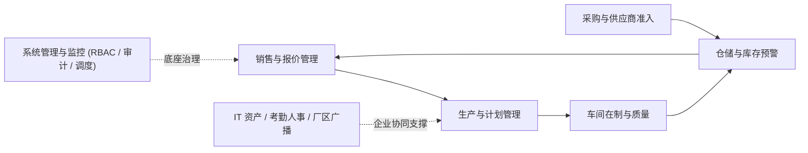

# 核心业务模块与集成说明

本文档按业务域梳理 **ctk-system** 已实现的功能模块、页面路由、核心能力及外部系统集成关系，帮助团队快速了解系统边界与可扩展点。

- 系统分层架构与核心机制请参见 [系统架构与开发指南](./architecture.md)
- 本地启动、容器部署与白标配置请参见 [部署与白标配置指南](./deployment.md)

---

## 1. 业务域全景概览

系统覆盖离散制造业「**销售报价 → 计划排产 → 车间在制与质量 → 仓储出入库与预警 → 行政人事与 IT 资产 → 系统治理**」的核心运营闭环：

---

## 2. 生产管理

围绕生产订单执行、工序良率、产出汇报与半成品流转，主要依托金蝶 K3Cloud SQL Server 直连与 MySQL 协同表实现实时洞察。

| 模块 | 前端路由 | 核心能力 | 主要数据与集成 |
| --- | --- | --- | --- |
| 生产订单 | `/tk_custom/productionOrder` | 生产订单多维度查询、执行状态跟踪及自动结案巡检 | K3 SQL Server / WebAPI、MySQL |
| 生产进度 | `/tk_custom/mo` | 制造工单（MO）各工序实时进度与齐套跟踪 | K3 SQL Server |
| 生产质量 | `/tk_custom/processYield` | 分工序良率统计、不良分布看板与趋势图表分析 | K3 SQL Server、ECharts |
| 产量汇报 | `/tk_custom/processOutputReport` | 工序日/月产量汇总、绩效统计与 Excel 报表导出 | K3 SQL Server、MySQL |
| 车间半成品在制 | `/tk_custom/wip` | 各工段半成品在制数量核算、期初/投入/产出/结存平衡与导出 | K3 SQL Server、MySQL |
| 车间半成品盘点 | `/tk_custom/pd` | 车间在制品盘点录入、与账面在制差异核对及盘点记录管理 | MySQL、K3 SQL Server |
| 生产入库 | `/tk_custom/productionReceipt` | 完工入库单查询与入库进度核对 | K3 WebAPI / SQL Server |
| 假片重量月度录入 | `/tk_custom/dummyPiece` | 生产辅料/工艺假片月度重量登记与成本核算支撑 | MySQL |

---

## 3. 销售与报价管理

支持外贸与内贸两套报价体系、电子表格式批量编辑、历史成交价走势及回款/交期主动预警。

| 模块 | 前端路由 | 核心能力 | 主要数据与集成 |
| --- | --- | --- | --- |
| 外贸销售报价单 | `/tk_custom/quotation` | 基于 RevoGrid 的多列电子表格编辑、批量粘贴/撤销、低价校验、终端客户冲突检测、有效期管理、多模板 Excel 导出与到期提醒 | MySQL、服务端 Excel 模板、企业微信通知 |
| 内贸销售报价单 | `/tk_custom/domesticQuotation` | 面向内贸口径的简化报价单维护、单位换算、月度汇总推送与 Excel 导出 | MySQL、企业微信通知 |
| 销售价格走势 | `/tk_custom/salesPriceTrend` | 按客户/物料追踪历史报价与成交价格波动曲线 | MySQL、K3 SQL Server、ECharts |
| 客户逾期应收 | `/tk_custom/customerOverdueAr` | 逾期应收账款查询、账龄分析、业务备注维护与定时催收提醒 | K3 SQL Server、MySQL、企业微信通知 |
| 客户样品进度 | `/tk_custom/sampleProgress` | 客户打样全流程进度跟踪、表格化行内编辑与状态导出 | MySQL |
| 销售交期预警 | `/tk_custom/deliveryAlert` | 临期/超期销售订单自动筛查、风险分级展示、定时推送与报表导出（支持角色级权限控制） | K3 SQL Server、MySQL、企业微信通知 |

---

## 4. 采购与供应商管理

| 模块 | 前端路由 | 核心能力 | 主要数据与集成 |
| --- | --- | --- | --- |
| 供应商准入与测试 | `/tk_custom/npi` | 新物料/新供应商导入（NPI）评审、样品测试跟踪与准入归档 | MySQL |

---

## 5. 仓储与库存预警

打通 ERP 即时库存、本地精细化库位（WMS）与安全库存阈值预警，支持条码化入库上架与出库核对。

| 模块 | 前端路由 | 核心能力 | 主要数据与集成 |
| --- | --- | --- | --- |
| 库存预警 | `/tk_custom/kucun_warning` | 物料安全库存配置、实时缺口计算、多类别筛选、手动/定时企业微信预警推送、每日快照与 Excel 导出 | MySQL、K3 WebAPI、企业微信通知 |
| 金蝶即时库存 | `/tk_custom/kingdee_inventory` | 实时拉取 ERP 各仓库/批次/物料维度即时库存并支持多条件检索 | K3 WebAPI |
| 仓库扩展库存 | `/tk_custom/kingdee_kucun` | 特定库区库存明细同步、差异核对与快速检索 | K3 WebAPI、MySQL |
| 仓库结构 | `/tk_custom/wmsStructure` | 仓库、库区、货架与库位树形主数据维护 | MySQL |
| 采购入库 | `/tk_custom/wmsInbound` | 采购收货核验、质检报告关联与入库单据协同 | MySQL、K3 WebAPI |
| 销售出库 | `/tk_custom/wmsOutbound` | 销售发货拣货、批次核对与 ERP 出库单据联动 | MySQL、K3 WebAPI |
| 库位上架 | `/tk_custom/localStockInbound` | 本地库位扫码上架、暂存区流转与库位库存查询 | MySQL、条码解析 |
| 标签管理 | `/tk_custom/tag` | 物料/外箱条码（Code 128 等）生成、模板维护与打印 | MySQL、前端条码渲染 |

---

## 6. 车间质量与现场协同

| 模块 | 前端路由 | 核心能力 | 主要数据与集成 |
| --- | --- | --- | --- |
| 异常单 | `/tk_custom/exception` | 车间品质/工艺异常提报、责任流转、改善闭环与记录导出 | MySQL |
| 异常看板 | `/tk_custom/exceptionDashboard` | 异常频次、分类占比与闭环率可视化统计看板 | MySQL、ECharts |
| 弹坑图片 | `/tk_custom/pic` | 质检显微/检验图片批量上传、缩略图预览（`sharp` 压缩）与灯箱检视 | MySQL、本地文件存储 |
| 意见建议 | `/tk_custom/suggest` | 员工改善提案收集、处理跟踪、定时推送与导出 | MySQL、企业微信通知 |
| 视频资料库 | `/tk_custom/videoLibrary` | 作业指导书（SOP）与培训视频分类管理与在线播放 | MySQL、本地媒体存储 |
| 焊线机工卡打印 | `/tk_custom/wireBondCard` | 车间设备工艺工卡排版与快速打印（默认仅管理员可见） | MySQL |

---

## 7. 企业内部运营、IT 资产与企微协同

将 IT 设备台账、人力资源、企微考勤、ESD 门禁及厂区广播统一纳入后台治理。

| 模块 | 前端路由 | 核心能力 | 主要数据与集成 |
| --- | --- | --- | --- |
| IT 资产管理 | `/tk_custom/itAsset` | 办公电脑/网络设备/外设台账管理、领用归还记录、Excel 批量导入导出与终端安全客户端数据同步 | MySQL |
| 考勤核算 | `/tk_custom/wecomAttendance` | 拉取企业微信打卡与审批记录，结合班次/员工档案自动核算工时、加班、请假与异常，支持白标抬头报表导出 | MySQL、企业微信 API |
| 入离职汇总 | `/tk_custom/employmentSummary` | 员工入职、离职与在职人数月度趋势统计、图表展示与报表导出 | MySQL、企业微信通讯录 |
| 人才库 | `/tk_custom/talent_pool` | 候选人简历归档、岗位匹配检索与跟进记录 | MySQL |
| ESD 门禁记录 | `/tk_custom/attendance` | 车间防静电（ESD）门禁检测与通行流水查询 | MySQL |
| 企业微信通讯录 | `/tk_custom/wxuser` | 企业微信组织架构与成员同步预览、差异校验及定时自动同步 | MySQL、企业微信 API |
| 企业微信消息 | `/tk_custom/msgtowx` | 企业微信应用消息/群机器人消息发送管理与推送记录查询 | MySQL、企业微信 API |
| 金蝶快捷指令 | `/tk_custom/kingdeeMaintenance` | 面向运维人员的 ERP 常用诊断与受控只读/维护指令入口 | K3 WebAPI / SQL Server |
| 厂区广播（Jukebox） | `/tk_custom/jukebox` | 厂区上下班铃声与背景音乐曲库管理、按周/节假日定时排程、手动插播、音量控制与播放状态监控 | MySQL、Nitro 内嵌播放器（MPV IPC / FFprobe） |
| 外发上锡导出 | `/tk_custom/wfExport` | 委外加工对账与明细数据一键格式化导出 | MySQL / K3 SQL Server |
| 抽奖管理 | `/tk_custom/lucky/admin` | 企业年会/活动抽奖规则配置、参与名单管理与中奖结果导出 | MySQL |

---

## 8. 系统管理与运行监控

沿用成熟的 RBAC 权限模型并全面适配 Nuxt 4 + Nitro 运行时：

### 系统管理（`/__nav/system`）

- **组织与权限**：用户管理（`/system/user`）、角色管理（`/system/role`）、部门管理（`/system/dept`）、岗位管理（`/system/post`）、权限目录（`/system/menu`），支持用户与角色双向授权及数据权限范围控制。
- **基础配置**：字典管理（`/system/dict`）、参数设置（`/system/config`）、通知公告（`/system/notice`）、个人中心（`/user/profile`）。

### 系统监控（`/__nav/monitor`）

- **安全与审计**：在线用户管理与强制下线（`/monitor/online`）、操作日志（`/monitor/operlog`）、登录日志（`/monitor/logininfor`）。
- **运维观测**：定时任务管理与调度日志（`/monitor/job`）、MySQL `sys_cache` 缓存监控（`/monitor/cache`）、服务端运行状态监控（`/monitor/server`）。

---

## 9. 外部集成汇总

所有外部集成均通过环境变量或数据库配置注入，源码中不包含任何特定企业的地址、账套名或凭据（详细配置项见 [部署与白标配置指南](./deployment.md)）：

| 外部系统 | 接入方式 | 覆盖业务场景 | 关键容错与安全机制 |
| --- | --- | --- | --- |
| **金蝶 K3Cloud（WebAPI）** | `server/utils/k3.ts`（`LoginByAppSecret`） | 即时库存、库存预警刷新、采购入库/销售出库单据读写 | 失败类型精细区分（配置/超时/权限/不可用）；演示模式硬拦截 |
| **金蝶 K3Cloud（SQL Server）** | `server/utils/sqlserver.ts`（`mssql`） | 生产订单、MO 进度、良率、产量、WIP、逾期应收、交期预警 | 主备地址切换、独立查询超时、只读查询与演示模式拦截 |
| **企业微信（WeCom）** | `server/utils/wecom-*.ts`、`wx-approve-*.ts` | 通讯录同步、审批同步、考勤核算、预警/报价/交期消息推送 | 支持手动预览后同步、定时开关可控、凭证仅存环境变量 |
| **厂区广播引擎（Jukebox）** | `server/utils/jukebox/` + `server/plugins/jukebox-player.ts` | 厂区定时打铃、背景音乐播放与曲库元数据探测 | 支持 `embedded` / 独立引擎模式、MPV IPC 控制与失败重试 |
